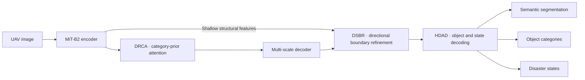

<div align="center">

# HDRNet

### Understand disaster scenes through relations, boundaries, and damage states.

**Hierarchical Damage-Aware Relation Refinement Network**<br>
*Post-disaster UAV image semantic segmentation*

[](https://github.com/MingJ-Zhang/HDRNet/actions/workflows/ci.yml)
[](pyproject.toml)
[](https://pytorch.org/)
[](LICENSE)

[Quick start](#quick-start) · [Architecture](#architecture) · [Results](#paper-results) · [Operations](docs/operations.md) · [Reproducibility](docs/reproducibility.md) · [Contributing](CONTRIBUTING.md)

</div>

Post-disaster imagery asks more than “what object is this?” It asks whether a
building is damaged, whether a road is flooded or blocked, and where an affected
object's fragmented boundary lies. HDRNet coordinates three complementary signals
on a MiT-B2 encoder: **category-prior-guided attention**, **directional boundary
refinement**, and **object-conditioned damage-state decoding**.

This release provides a modular PyTorch implementation with training, evaluation,
single-image inference, experiment records and automated tests. Paper-reported
results are identified separately from measurements generated by this code.

## Paper results

| Benchmark | SegFormer-B2 mIoU ↑ | HDRNet mIoU ↑ | Improvement |
|:--|--:|--:|--:|
| FloodNet | 71.10 | **73.04** | **+1.94 pp** |
| RescueNet | 63.70 | **65.59** | **+1.89 pp** |
| FWISD | 60.96 | **62.94** | **+1.98 pp** |

The manuscript reports **25.83M parameters**, **32.36G FLOPs**, **1003 MB peak GPU
memory**, and **67.2 FPS** for HDRNet under its controlled A800, 512×512,
batch-one protocol. These are paper measurements, not CI results or a throughput
guarantee for arbitrary hardware. Use `tools.benchmark` to measure the installed
implementation in your environment.

The v0.2 FloodNet reference graph contains **30,870,552 parameters (30.87M)**.
It has a different capacity from the paper's archived 25.83M graph; the paper
scores must not be attributed to a newly trained v0.2 checkpoint without evaluation.

## Architecture



| Component | Question it addresses | Implementation |
|:--|:--|:--|
| **DRCA** | Which classes provide context for each other? | Image-conditioned category attention guided by a fixed training-set prior; semantic gating over five context branches. |
| **DSBR** | Where are degraded object boundaries? | Selected-class morphological supervision and four trainable directional response groups. |
| **HDAD** | What object is present, and what is its state? | Separate object-conditioned state heads; monotone cumulative thresholds for RescueNet building damage. |

The code for each mechanism lives in its own module. Auxiliary supervision uses
existing semantic masks; no separate boundary annotation is required.

## Quick start

Install a CUDA-compatible PyTorch build using the [official installation guide](https://pytorch.org/get-started/locally/), then:

```bash
git clone https://github.com/MingJ-Zhang/HDRNet.git
cd HDRNet
python -m pip install -e .

# Validate the configured image/mask pairs and class IDs.
python -m tools.check_data --dataset floodnet --data-root /data/FloodNet

# Train; a category prior is estimated from training masks automatically.
python -m tools.train --model hdrnet --dataset floodnet --data-root /data/FloodNet \
  --work-dir work_dirs/hdrnet_floodnet --seed 42

# Evaluate and retain a full confusion matrix with per-class metrics.
python -m tools.test --model hdrnet --dataset floodnet --data-root /data/FloodNet \
  --checkpoint work_dirs/hdrnet_floodnet/iter_80000.pth \
  --output outputs/floodnet_metrics.json
```

For CPU use, add `--device cpu`. In PowerShell, put each command on a single line
or use its backtick continuation character instead of the Bash backslash.
Datasets and pretrained weights are obtained separately; their directory layouts
and initialization requirements are described in [Operations](docs/operations.md).

### Scale to two GPUs

```bash
torchrun --standalone --nproc_per_node=2 -m tools.train \
  --model hdrnet --dataset rescuenet --data-root /data/RescueNet \
  --work-dir work_dirs/hdrnet_rescuenet --batch-size 8 --seed 42
```

Batch size is per process: two GPUs at eight images each yield a total batch of
16. FP32 is the default; optional AMP and synchronized BatchNorm are explicit
flags. CUDA execution is required when CUDA is requested, with a visible error
if the device is unavailable.

### Predict an image

```bash
python -m tools.predict --dataset floodnet --image /data/example.jpg \
  --checkpoint work_dirs/hdrnet_floodnet/iter_80000.pth \
  --output-dir outputs/example
```

The output contains an indexed segmentation mask, a color map, an overlay and
checkpoint-linked metadata. Sliding-window inference preserves the input extent.

## Engineering features

| Capability | Concrete artifact |
|:--|:--|
| **Traceable experiments** | Configuration, class ontology, Git revision, software/device environment, effective batch size and JSONL loss records. |
| **Recoverable training** | Atomic checkpoints with model, optimizer, AMP scaler, sampler position and per-process RNG state. |
| **Auditable evaluation** | Per-class IoU/F1/support, original confusion matrix and checkpoint SHA-256 exported as JSON. |
| **Validated data contracts** | Missing masks, RGB annotations, size mismatches and unknown class IDs raise actionable errors. |
| **Explicit performance protocol** | Warm-up, repeated synchronized inference, latency dispersion, parameter count and CUDA memory. |
| **Continuous checks** | CPU tests for model gradients, ordinal probabilities, ignore handling, priors, metrics, inference coverage and recovery; lint and wheel builds in GitHub Actions. |

```text
HDRNet/
├── hdrnet/                 # Encoder, DRCA, DSBR, HDAD, losses and runtime
│   ├── data/               # Dataset contracts, augmentation, prior estimation
│   └── engine/             # Metrics, inference, optimization schedule
├── configs/                # Dataset ontologies and shared protocol
├── tools/                  # Train, evaluate, predict, benchmark and validate data
├── baselines/              # Reference adapters and explicitly marked prototypes
├── tests/                  # Behavioral and integration checks
├── docs/                   # Operations, provenance and baseline sources
└── .github/                # CI and collaboration templates
```

## Reproduction and comparison models

The manuscript experiments and this public reference implementation have distinct
provenance. Original manuscript checkpoints are not bundled. Fresh training of the
public implementation needs its own evaluation; it does not automatically recover
the manuscript table. Version 0.2 corrects head/loss behavior and changes checkpoint
compatibility. See [Evidence and release provenance](docs/reproducibility.md).

SegFormer and DA-SegFormer use MiT-B2 in the local controlled-comparison interface.
The original DA-SegFormer study uses MiT-B4. Several additional comparison files are
lightweight interface prototypes rather than official architectures; their factory
emits a warning. [Baseline integration status](docs/baselines.md) identifies them
and links the upstream implementations needed for scientific comparison.

## Development

```bash
python -m pip install -e '.[dev]'
ruff check .
pytest -q
python -m build
```

Contributions are welcome: reproducible bug reports, tested improvements, dataset
adapters and checkpoint conversion tools. Include configuration and evaluation
artifacts when reporting results. See [Contributing](CONTRIBUTING.md),
[Security](SECURITY.md) and [Changelog](CHANGELOG.md).

## Citation and license

Use GitHub's **Cite this repository** entry, generated from [CITATION.cff](CITATION.cff),
and identify the code version or commit used in an experiment. The manuscript is:

> Mingjie Zhang, Xiangyin Zhang, Kai Chen, and Yongxu Zhou. *HDRNet: Hierarchical
> Damage-Aware Relation Refinement Network for Post-Disaster UAV Image Segmentation.*

Code is distributed under [Apache-2.0](LICENSE). External datasets, upstream
implementations and pretrained weights retain their respective terms.
